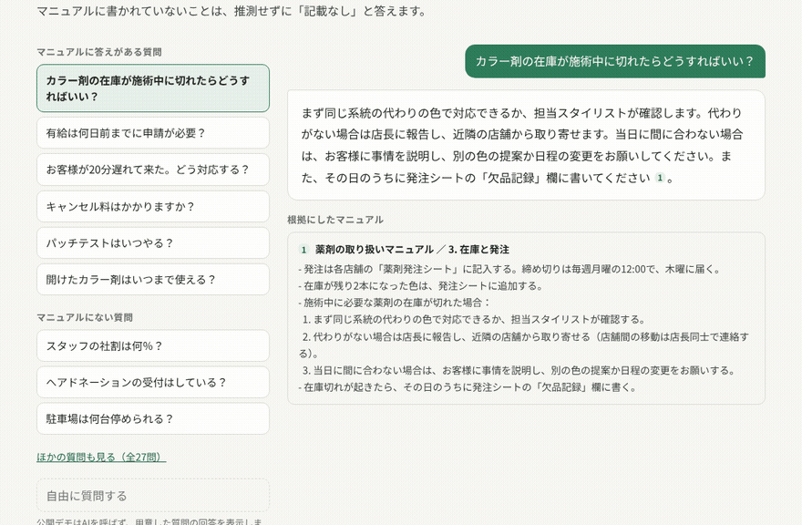

# salon-manual-qa

美容室の社内マニュアルに、**根拠を示して答える**AIチャットのデモです。マニュアルにないことは推測せず「記載なし」と答えます。

**公開デモ：https://takahkok0812.github.io/salon-manual-qa/**（質問を選ぶと、根拠つきの回答と「記載なし」の判断を表示します）



> 開発中（2026年11月〜12月）。サンプルのマニュアルは架空の美容室チェーン「みどり坂ヘア」のもので、実在の店舗・規則とは関係ありません。
> 公開デモはAIを呼ばず、評価用の質問27問への回答をあらかじめ作って表示しています（費用0円）。

## できること

| 機能 | 状態 |
| --- | --- |
| マニュアル（Markdown・テキスト）の取り込み：分割 → 埋め込み → 保存 | 済み（AWS上で、S3に置くと Lambda が分割・埋め込みして DynamoDB に保存。サンプル5本で110件を確認） |
| 質問への回答：関連箇所を検索し、AIが根拠の番号つきで回答 | 済み（評価27問で期待どおり27問） |
| 根拠がないときは「記載なし」と答える | 済み（ふるい分け＋AIの判断の2段階） |
| 公開デモ：事前に作った回答を、根拠と一緒に表示する | 済み（GitHub Pages） |
| 自由な質問（ログインした人だけ、1日数回まで） | 手元で動作（デモ用2ロールのログイン、1日の回数制限、E2Eテスト）。AWSへの公開は次 |
| 回答への「役に立った／立たなかった」、未解決の質問の記録 | 未着手 |
| 管理画面：文書の一覧・削除、質問ログ、未解決の質問 | 未着手 |
| ログイン：スタッフ／店長の2ロール | 済み（HS256のJWTをHttpOnly Cookieに保存。管理画面の権限分けは次） |

## 構成

- 画面とAPI：Next.js（App Router・TypeScript）。公開デモは静的に書き出して GitHub Pages で配信、ログイン後の画面とAPIは AWS Amplify Hosting の予定
- 回答：Amazon Bedrock（モデルは切り替え式。公開デモの回答は Nova Pro）
- 埋め込み：Amazon Bedrock の Titan Text Embeddings V2
- 保存：原本は S3、分割した文書・埋め込み・質問ログは DynamoDB
- 取り込み：S3 へのアップロードで Lambda が起動（`infra/template.yaml`、AWS SAM）

## 設計で決めたこと

- **常時課金のあるサービスを使わない**：ベクトル検索専用のサービスはデモには重いので、数千件まではサーバー側で類似度を計算する。検索部分は `VectorStore` で差し替えられるようにしてある（`src/lib/search.ts`）。
- **分からないときは答えない**：類似度が低い質問はAIを呼ばずに「記載なし」、それ以外は根拠を渡してAIに判断させる（評価の結果から決めた。下の「評価の結果」参照）。
- **費用をほぼ0円にする**：期限なしの無料枠があるLambda・DynamoDB・S3を中心に組み、置いておくだけで課金されるサービス（NATゲートウェイ、検索専用サービス、RDSなど）は使わない。
- **公開デモはAIを呼ばない**：公開デモでは、サンプル質問への回答をあらかじめ生成して保存したものを表示する。本物のAIが答える「自由に質問」はログインした人だけ、1日数回まで。
- **予算アラート**：AWSの予算アラート（約1,000円）をテンプレートに含める。

## 回答の評価

`samples/eval/questions.json` に27件の質問があります（答えがある17件、マニュアルにない10件）。
正解の文書と見出しが検索の上位3件に入る割合と、記載がない質問で「記載なし」と答えられた割合を測ります。

## 検索の精度を測る（手元で）

```powershell
aws login --region ap-southeast-2   # 初回・期限切れのとき
npm run index                       # サンプル5本を分割し、Bedrock の Titan で埋め込み → .data/index.json
npm run eval                        # 評価用の質問27件で、正解の見出しが上位3件に入る割合を表示
npm run models                      # 回答に使えるモデル（推論プロファイル）のIDを一覧
$env:ANSWER_MODEL_ID="<上で出たID>"; npm run eval -- --answer 3   # 答えありの先頭3問＋記載なしの全問を実際に回答させる
```

AWSを呼ばずに流れだけ試すときは `$env:EMBEDDER="local"` を付けます（文字の並びだけで比べる簡易版）。
`npm run eval` の結果は `.data/eval-latest.md` にも保存されます。

### 評価の結果と、そこから決めたこと

| 段階 | 上位3件の正解率（答えあり17問） | 回答の判定 |
|---|---|---|
| 簡易版の埋め込み（文字の並び） | 82% | － |
| Titan Text Embeddings V2（見出し単位） | 94%（q10 を外す） | 20問中19問 |
| ＋箇条書き1項目単位でも検索 | 94%（q10 を外す） | － |
| ＋用語集で関連語を書き足す | **100%** | **27問中27問**（記載なし10問を含む） |

回答は Nova 2 Lite（`global.amazon.nova-2-lite-v1:0`）で確認しました。

- **用語集**（`samples/glossary.json`）：q10「買ったシャンプーを返品したい」は、マニュアルの言い方が「店販品」で検索に掛かりませんでした。社内の言い方と質問での言い方の対応表を用意し、用語を含む区切りの埋め込みに関連語を書き足しています（本文は変えません）。
- **小さな単位で探し、見出しの全文を渡す**：箇条書き1項目ごとにも埋め込みを作って探し、AIには親の見出しの全文を渡します。1つの見出しに話題が複数あっても埋もれにくくするためです。
- **「記載なし」は2段階で判断**：類似度は答えありと記載なしで重なり、しきい値だけでは判定できませんでした。特に q25「有給休暇は年に何日もらえる？」は、話題が同じなので類似度が全問で一番高く（0.533）なります。そこで、類似度 0.2 未満だけをAIを呼ばずに「記載なし」とし（費用を抑えるふるい分け）、それ以外は根拠を渡したうえでAIに判断させています。記載なし10問のうち、ふるい分けで1問、AIの判断で9問を「記載なし」と答えました。
- **言葉の重なりを混ぜる検索は使わない**：意味の近さに文字の重なりを混ぜる比率（0〜0.5）も比べましたが、正解率は変わらず、記載なしとの分離も改善しなかったため、既定は 0（混ぜない）にしています。比較表は `npm run eval` が毎回出力します。
- **回答の指示**：q03 で、AIが資料にない手順（「丁寧に説明する」など）を根拠番号付きで付け足したため、指示に「資料にない手順を付け足さない」を加えました。

回答に使うモデルは `ANSWER_PROVIDER`（`bedrock` または `anthropic`）と `ANSWER_MODEL_ID` で切り替えます。`anthropic` のときは `ANTHROPIC_API_KEY` も設定します。

### 決まったコマンドを、ファイル経由で実行する（任意）

`npm run runner` を起動しておくと、`.data/request.txt` に書かれたジョブを1つずつ実行し、ログを `.data/run-latest.md` に残します。
実行できるのは `scripts/runner.ps1` に書いた決まったコマンド（pull / ci / index / eval / eval-answer N / models / whoami / check / update）だけです。
環境変数は `.data/runner.env`（`ANSWER_MODEL_ID=...` などの行）から、許可したキーだけを読み込みます。

### ログインして自由に質問する（手元で）

```powershell
npm run dev   # http://localhost:3000/chat
```

- 「スタッフで入る」「店長で入る」でログインし、マニュアルについて自由に質問できます（1日5回まで。`DAILY_QUESTION_LIMIT` で変更）。
- AWS につながずに画面の流れだけ試すときは `$env:EMBEDDER="local"; $env:ANSWER_PROVIDER="fake"` を付けます。
- 画面とAPI（`*.live.ts(x)`）は、GitHub Pages 用の静的書き出しには含めません（`next.config.ts`）。

## 開発

```bash
npm ci
npm run dev        # http://localhost:3000
npm run lint
npm run typecheck
npm test           # Vitest
npm run e2e        # Playwright（ビルドして起動してから実行）
```

AWSへのデプロイ（取り込み部分）と、サンプルの取り込み：

```bash
sam build
sam deploy --parameter-overrides AlertEmail=you@example.com
npm run aws:upload   # 用語集 → マニュアル5本の順にS3へ置く（置くと取り込みLambdaが動く）
npm run aws:status   # 取り込まれた区切りの件数を文書ごとに表示
```

日本語の Windows で `sam` を使うときは、`$env:PYTHONUTF8="1"` を設定してください（設定ファイルを Shift_JIS として読んで失敗するため）。

リージョンはシドニー（ap-southeast-2）です。AWSの無料プランでは、プロジェクトのリージョンがシドニーに固定されるためです（`samconfig.toml`）。Bedrockの Titan Text Embeddings V2 と Nova はシドニーから使えます（Claude はアカウントの申請の反映待ち）。

## ディレクトリ

```text
src/app/             画面（Next.js）
src/lib/chunk.ts     Markdownを見出しごとに分割
src/lib/search.ts    類似度計算・検索の差し替え口・根拠の有無の判定
src/lib/prompt.ts    Claudeに渡すプロンプト
src/lib/embed.ts     埋め込み（Bedrock Titan／AWSを呼ばない簡易版）
src/lib/answer.ts    回答（Bedrock Converse／Claude API）と、根拠がないときはAIを呼ばない処理
src/lib/evaluate.ts  検索の評価（上位k件の正解率・しきい値の候補）
scripts/             索引づくり・評価・モデル一覧のスクリプト
functions/ingest/    取り込み用Lambda
infra/template.yaml  AWS SAMのテンプレート
samples/manuals/     サンプルのマニュアル（架空）
samples/eval/        評価用の質問セット
e2e/                 Playwrightのテスト
```
