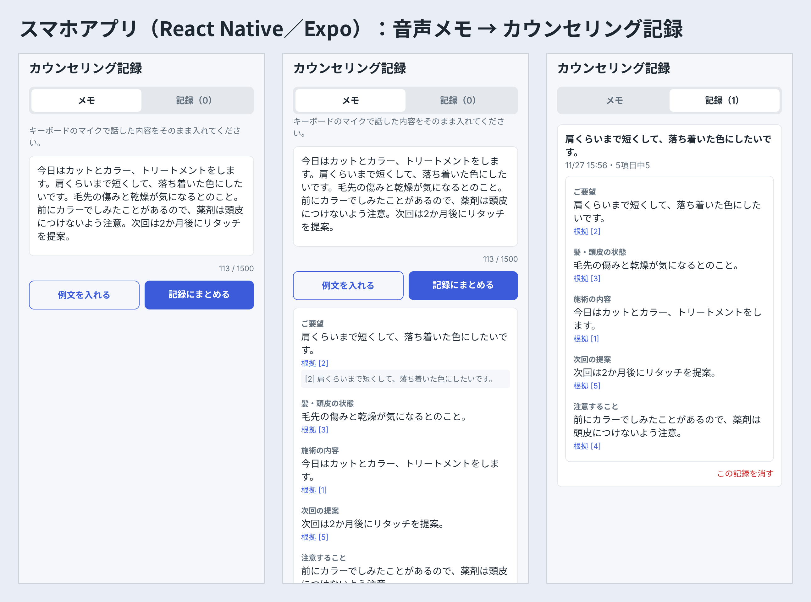

# カウンセリング記録（スマホ版・試作）

Expo（SDK 58）／React Native の見本。


Web版の音声メモ機能と同じ要約ロジック（`../src/lib/summarize.ts`）をそのまま使う。

- メモ：キーボードの音声入力（マイク）で話した内容を入れ、「記録にまとめる」で5項目に分ける
- 各項目の「根拠 [n]」を押すと、もとになった文を表示（根拠のない内容は「記載なし」）
- 記録：保存した記録の一覧。押すと中身を開く
- 「見本（通信なし）」と「AIでまとめる」を切り替えられる
  - 見本：`fakeGenerate`（キーワードで当てる）で、通信しない
  - AI：Web版と同じ API（`/api/session` でデモ用スタッフとしてログイン → `/api/summarize`）を呼ぶ。回数制限（1人1日5回・全体で1日30回）とAIの出力の検査はサーバー側。返事は `src/api.ts` でも形を確かめ、根拠の番号がない項目は「記載なし」にする
  - ブラウザ表示（`w` キー）は別オリジンの API を呼べないため、見本だけ
- API の場所は `EXPO_PUBLIC_API_BASE_URL` で変えられる（未設定なら公開デモの Amplify）

## 動かし方

```bash
cd mobile
npm install
npx expo start   # 表示されたQRコードを Expo Go で読む（w キーでブラウザ表示）
```

## 確認

```bash
npm run typecheck   # mobile の型チェック
npm run lint
cd .. && npx vitest run mobile   # 記録の操作・API の呼び方（ログイン・401で再ログイン・429）・返事の検査
```

親フォルダのファイルを読むため、`metro.config.js` で `../src/lib` を `watchFolders` に足している。
